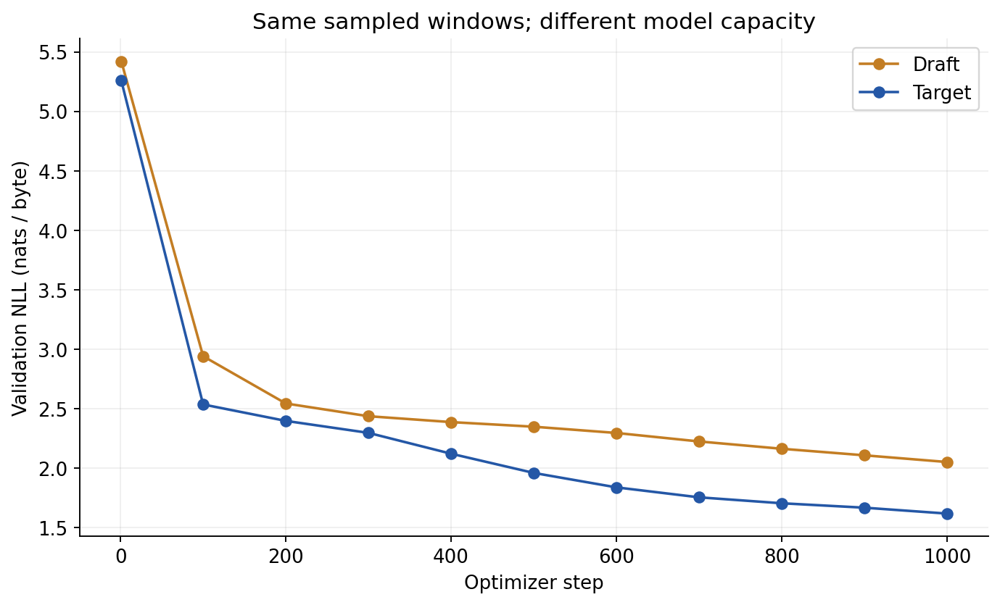
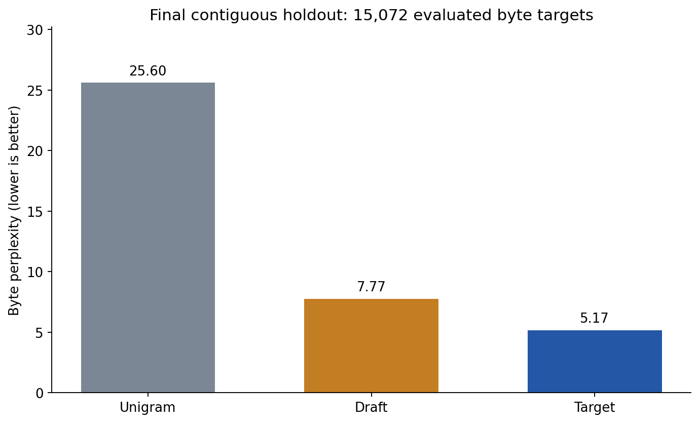
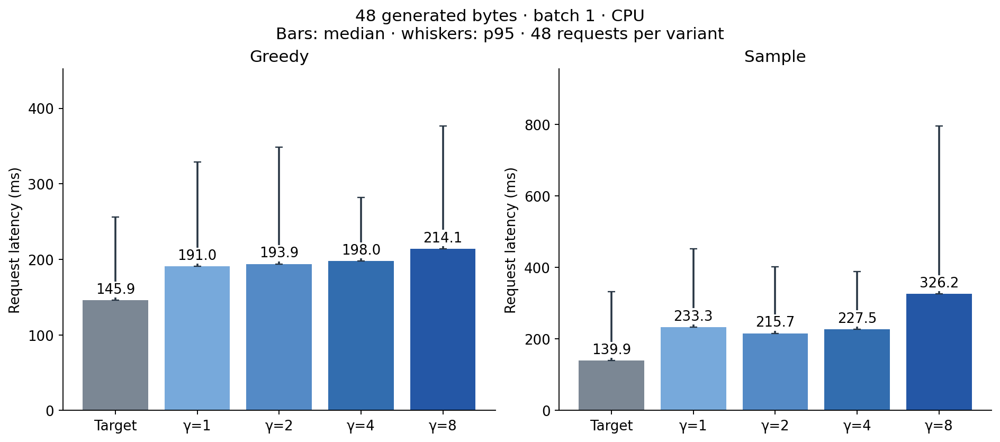
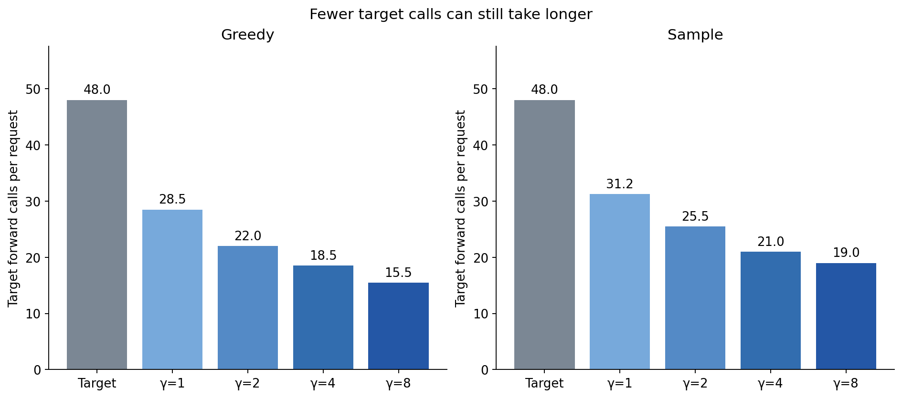
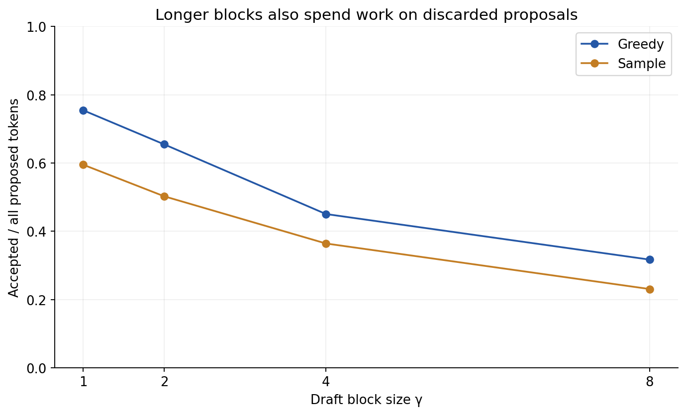
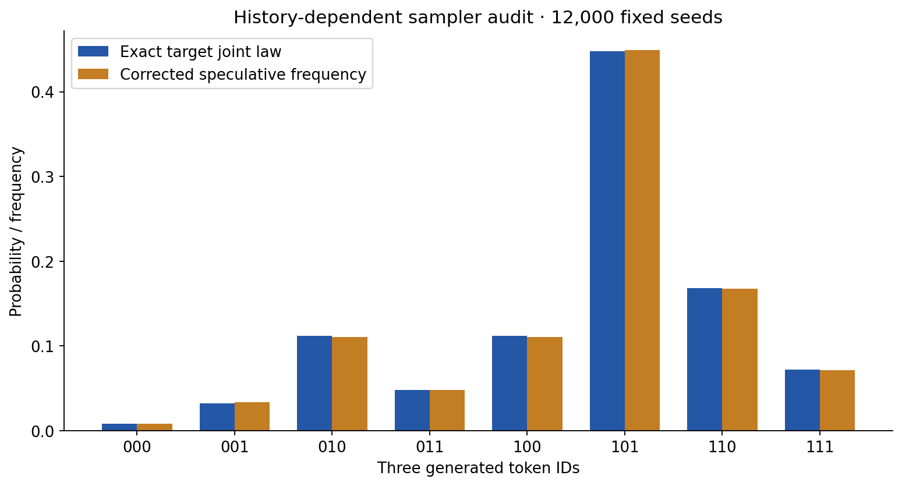

# الاستدلال بالاقتراح والتحقق

محرك استدلال تخميني مبني باستخدام TensorFlow، بنموذج صغير يقترح البايتات ونموذج هدف يتحقق منها، مع تصحيح احتمالي والتراجع عن التخزين المؤقت عند الرفض.

دُرب النموذجان من الصفر على 151,095 بايتًا من «أليس في بلاد العجائب». يحتوي النموذج الهدف على 311,616 معاملًا، والمقترِح على 40,224. اختيرت نقطتا الحفظ بصورة مستقلة على التحقق.

تستخدم نتيجة الاختبار 15,072 هدف بايت في نوافذ لا تتداخل أهدافها. انخفاض استدعاءات النموذج الهدف لم يحقق تحسنًا في زمن التنفيذ على المعالج المركزي. عند حجم اقتراح 4 انخفضت الاستدعاءات 61.46%، بينما زاد وسيط الزمن 35.65%.

تشمل الكلفة تجهيز السياق وتوليد المقترحات والتحقق وتصحيح الاحتمال والتراجع والتزامن. تختلف جودة توزيعات العينات عن تطابق المخرجات مع البذرة نفسها؛ التصحيح يستهدف توزيع النموذج، ولا يضمن مسارًا نصيًا متطابقًا لكل بذرة.

تتضمن الأدلة 15 اختبارًا و2,560 مقارنة للرموز الجشعة، وفحص توزيع متعدد الخطوات عبر 12,000 بذرة ثابتة على نموذج مبسط قابل للحصر. لا يجوز تعميم قياسات هذا المعالج على معالجات رسومية أو نماذج أكبر.

## النتائج المسجّلة

الأرقام التالية من التنفيذ المحفوظ لهذه النسخة؛ لم تُعَد التجارب أثناء تعريب التوثيق.

### اختيار نقطة الحفظ على التحقق

| النموذج | المعاملات | الخطوة المختارة | NLL للتحقق بوحدة نات لكل بايت | حيرة البايت |
| :--- | ---: | ---: | ---: | ---: |
| النموذج الهدف | 311,616 | 1,000 | 1.6164 | 5.0350 |
| النموذج المقترِح | 40,224 | 1,000 | 2.0501 | 7.7685 |

### التقييم النهائي على الاختبار المحفوظ

| النموذج | NLL بوحدة نات لكل بايت ↓ | حيرة البايت ↓ | دقة البايت التالي ↑ |
| :--- | ---: | ---: | ---: |
| **النموذج الهدف** | **1.6426** | **5.1685** | **52.50%** |
| النموذج المقترِح | 2.0504 | 7.7708 | 41.95% |
| خط أساس أحادي الرموز | 3.2425 | 25.5983 | — |

### الاستدلال بالاختيار الجشع

| مفكّك الترميز | المقبول من المقترحات | متوسط استدعاءات النموذج الهدف | الوسيط بالمللي ثانية ↓ | المئين 95 بالمللي ثانية ↓ | نسبة السرعة ↑ |
| :--- | ---: | ---: | ---: | ---: | ---: |
| النموذج الهدف وحده مع تخزين مؤقت | — | 48.0 | **145.94** | 256.32 | 1.000× |
| كتلة اقتراح بحجم 1 | 75.45% | 28.5 | 190.96 | 329.21 | 0.764× |
| كتلة اقتراح بحجم 2 | 65.48% | 22.0 | 193.92 | 348.29 | 0.753× |
| كتلة اقتراح بحجم 4 | 45.05% | 18.5 | 197.96 | 282.17 | 0.737× |
| كتلة اقتراح بحجم 8 | 31.70% | 15.5 | 214.15 | 376.82 | 0.681× |

### أخذ العينات مع تصحيح الاحتمال

| مفكّك الترميز | المقبول من المقترحات | متوسط استدعاءات النموذج الهدف | الوسيط بالمللي ثانية ↓ | المئين 95 بالمللي ثانية ↓ | نسبة السرعة ↑ |
| :--- | ---: | ---: | ---: | ---: | ---: |
| النموذج الهدف وحده مع تخزين مؤقت | — | 48.0 | **139.91** | 332.83 | 1.000× |
| كتلة اقتراح بحجم 1 | 59.50% | 31.25 | 233.26 | 451.80 | 0.600× |
| كتلة اقتراح بحجم 2 | 50.26% | 25.50 | 215.74 | 401.90 | 0.649× |
| كتلة اقتراح بحجم 4 | 36.42% | 21.00 | 227.47 | 389.00 | 0.615× |
| كتلة اقتراح بحجم 8 | 23.08% | 19.00 | 326.18 | 795.84 | 0.429× |

### البنية and Verification

| المكوّن | النموذج المقترِح | النموذج الهدف |
| :--- | ---: | ---: |
| مفكّك الترميز blocks | 1 | 3 |
| النموذج width | 48 | 96 |
| رؤوس الانتباه | 4 | 4 |
| العرض الخفي لطبقة SwiGLU | 96 | 192 |
| Context | 96 bytes | 96 bytes |
| مفردات الرموز | 256 | 256 |

### ملفات المشروع

| المسار | المحتوى |
| :--- | :--- |
| `specforge/model.py` | مفكّك ترميز TensorFlow وعمليات كتل المفاتيح والقيم وواجهة الخلفية. |
| `specforge/decoding.py` | تحقق مستقل عن إطار العمل وتصحيح المتبقي والتراجع. |
| `generate.py` | واجهة أوامر للتوليد بالنموذج الهدف أو بالاقتراح والتحقق باستخدام نقاط الحفظ. |
| `prepare.py`, `study.py` | إعداد النص مع فحص البصمات وتدريب بميزانية ثابتة. |
| `benchmark.py` | توقيت بترتيب تنفيذ متوازن ومعرّفات مخرجات محفوظة. |
| `sampler_check.py` | توزيع دقيق لنموذج محدود وتدقيق التكرارات ببذور ثابتة. |
| `verify.py`, `artifacts.py` | إعادة فحص الدرجات والمخرجات والمصدر وقائمة واضحة لملفات النشر. |
| `plots.py`, `figures/` | رسوم مبنية على القياسات المنفذة. |
| `runs/draft/`, `runs/target/` | الإعدادات والأوزان وخسائر نوافذ الاختبار والعينات الخام. |
| `runs/metrics.json` | درجات التحقق والاختبار وضوابط التجربة والبيئة. |
| `runs/benchmark.json` | جميع مشاهدات التوقيت الـ480 وملخصاتها ومدخلاتها ومعرّفاتها وأعداد الاستدعاء. |
| `runs/training_starts.npy`, `runs/training_history.csv` | جدول النوافذ الفعلي وملاحظات التدريب. |
| `runs/error_analysis.json`, `runs/sampler_check.json` | نوافذ الأخطاء وتشخيص آلية أخذ العينات. |
| `data/manifest.json`, `audit.json` | إسناد المصادر وفحوص التنفيذ وبصمات الملفات. |
| `tests/`, `USAGE.md` | اختبارات الصحة وعقد التكامل واستخدام واجهة الأوامر. |

## الرسوم والنتائج المرئية

الرسوم محفوظة من التنفيذ الأصلي. تعريب هذه الصفحة لا يغيّر بياناتها أو تسميات الصور داخل الملفات.

## الملفات المرجعية

- [درجات التنفيذ المحفوظة](runs/metrics.json).
- [بيانات التدقيق وبيئة التنفيذ](audit.json).
- [مرجع البيانات وبصماتها وحدود التقسيم](data/manifest.json).
- [تفاصيل استخدام الأداة](USAGE.md).

## المصادر والإسناد

- [مصدر 1: Leviathan et al., *Fast Inference from Transformers via Speculative Decoding*](https://proceedings.mlr.press/v202/leviathan23a.html).
- [مصدر 2: Lewis Carroll, *Alice's Adventures in Wonderland*, Project Gutenberg ebook 11](https://www.gutenberg.org/ebooks/11).

[المرجع التقني الإنجليزي الكامل](README.en.md) يحفظ تفاصيل النسخة الأصلية. تُترك أسماء الملفات والأوامر ومعرّفات النماذج والمقاييس بصيغتها التقنية لضمان تطابقها مع الكود.
